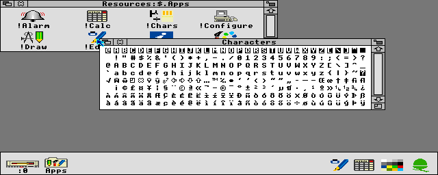

# DreamRISC3

RISC OS 3.11 running natively on the Sega Dreamcast, built on KallistiOS.

**This is not an emulator and there is no JIT.** The Acorn ROM is ARM code with no public source, so a tool recompiles it ahead of time into C and then SH-4. The ELF holds the native code, and the original hardware pokes land in native drivers.



## Status

- **Runs on a real Dreamcast**: boots to the desktop in ~26-31s, with screen memory checksums matching the Mac harness exactly
- A scripted run on the console opens a Filer window and launches `!Calc`, `!Chars` and `!Edit`, again matching the harness at every checkpoint
- Known issue: 1 of 9 console boots stuck before the desktop. Not reproduced since, cause unknown
- Physical keyboard, mouse and controller are untested on hardware, and nobody has looked at the real video output yet
- **Hard disc on SD**: with an SD card on the serial port adapter, RISC OS gets a real ADFS hard disc at `:4`, up to ~476MB. Saves survive power off. **Formatting erases the whole card**, and the first boot asks first (A/Y to format, B/N to skip)
- With no card, floppy `:0` holds an ADFS E disc called DreamRISC. Saves there are lost at power off
- The desktop runs in mode 27, a true 640x480 in 16 colours. Lower resolution modes, like Lander's, are still stretched to fit
- Sound plays through the AICA: beeps, BASIC's `SOUND` and anything else using the RISC OS sound system. Checked by recording it on the harness and by ring counters in Flycast; nobody has listened to it on a console yet
- `!Draw` and `!Paint` load on demand from disc as code overlays, and rarely used ROM pages stream too. Verified on real hardware over dcload and from a disc image in Flycast; reading a real disc on the console is untested
- **Lander** is in the Apps folder, recompiled from its ARM binary and streamed from disc when launched. Locked 25 frames/s on the console, played by script only so far
- Memory: ~14.7MB of 16MB with a card (8.8MB ELF, ~1.9MB ROM cache, 4MB guest RAM), plus 0.8MB for the floppy image without one

## Build

You need your own RISC OS 3.11 ROM. It is never committed. Default location is `../arculator-mac/roms/riscos311`; override with `ROM_DIR`.

The first build downloads bundled apps, pinned by hash, into `build/upstream/`. Lander's upstream repo has no licence, so like the ROM it stays out of this repo and images should not be published. See [apps/README.md](apps/README.md).

Host tools: KallistiOS, Python 3, meson, ninja, pkg-config and libisofs (`brew install meson ninja pkg-config libisofs`). The disc-image tool mkdcdisc is vendored under [tools/mkdcdisc](tools/mkdcdisc/VENDOR.md) and built into `build/mkdcdisc/` on first run; set `MKDCDISC` to use another binary.

```bash
scripts/build-dc.sh
```

```bash
scripts/run-flycast.sh
```

`scripts/stop-flycast.sh` stops only the instance this checkout launched.

Controls: mouse left/right/middle are Select/Menu/Adjust. On a controller, stick or D-pad moves the pointer, A/B/X are Select/Menu/Adjust, Start is Escape and Y is Return.

See [docs/ARCHITECTURE.md](docs/ARCHITECTURE.md) for how it works and how to test it.
