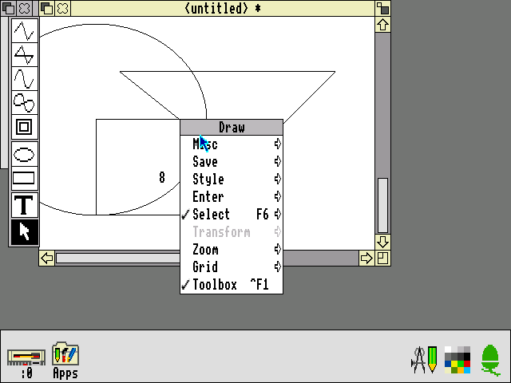
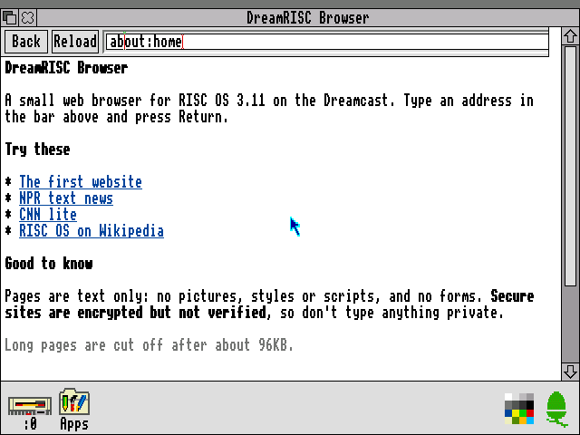
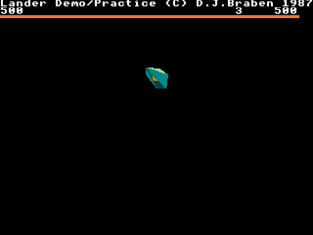

# DreamRISC3

RISC OS 3.11 running natively on the Sega Dreamcast, built on KallistiOS.

**This is not an emulator and there is no JIT.** The Acorn ROM is ARM code with no public source, so a tool recompiles it ahead of time into C and then SH-4. The ELF holds the native code, and the original hardware pokes land in native drivers.

<table>
  <tr>
    <td></td>
    <td></td>
  </tr>
  <tr>
    <td></td>
    <td></td>
  </tr>
</table>

## Status

- **Runs on a real Dreamcast**: boots to the desktop in ~26-31s, with screen memory checksums matching the Mac harness exactly
- A scripted run on the console opens a Filer window and launches `!Calc`, `!Chars` and `!Edit`, again matching the harness at every checkpoint
- Known issue: 1 of 9 console boots stuck before the desktop. Not reproduced since, cause unknown
- Physical keyboard, mouse and controller are untested on hardware, and nobody has looked at the real video output yet
- **Hard disc on SD**: with an SD card on the serial port adapter, RISC OS gets a real ADFS hard disc at `:4`, up to ~476MB. Saves survive power off. **Formatting erases the whole card**, and the first boot asks first (A/Y to format, B/N to skip)
- With no card, floppy `:0` holds an ADFS E disc called DreamRISC. Saves there are lost at power off
- **Software archive**: the build bundles the Acorn Archimedes TOSEC set (136 titles: games, apps, demos, compilations) as a read-only ADFS hard disc called `Archive`, streamed off the CD. It mounts as `:4`, or `:5` with an SD card. The original ARM code runs through the interpreter in `src/interp.c`. Lemmings and Repton 3 have been played from it on the harness; the rest is untested, and anything that insists on `ADFS::0` or copy protection won't run. `scripts/build-dc.sh --include-archive-software off` leaves it out
- The desktop runs in mode 27, a true 640x480 in 16 colours. Lower resolution modes, like Lander's, are still stretched to fit
- Sound plays through the AICA: beeps, BASIC's `SOUND` and anything else using the RISC OS sound system. Checked by recording it on the harness and by ring counters in Flycast; nobody has listened to it on a console yet
- `!Draw` and `!Paint` load on demand from disc as code overlays, and rarely used ROM pages stream too. Verified on real hardware over dcload and from a disc image in Flycast; reading a real disc on the console is untested
- **Lander** is in the Apps folder, recompiled from its ARM binary and streamed from disc when launched. Locked 25 frames/s on the console, played by script only so far
- **Tertis** (SICK, 1993) is in there too, same treatment. Played by script on the harness and in Flycast, not yet on real hardware
- **Network**: `!Ping` and `!NetSetup` are in the Apps folder. A Broadband or LAN Adapter comes up by itself with DHCP; the modem (DreamPi) and W5500 are picked in `!NetSetup`. BBA and modem work in Flycast. On a real BBA under dcload the stack pinged the gateway at 2-3ms, but launching `!Ping` by script was unreliable there; not yet tried without dcload
- **Web**: `!Web` in the Apps folder is a small text browser with HTTP, HTTPS, forms and search. Google, DuckDuckGo, Hacker News and Wikipedia work in Flycast, and real sites have loaded on a console, but the window and a fetch have only run together in Flycast and on the harness. HTTPS is encrypted but certificates are not verified, so don't use it for anything private
- **Logo** is in the Apps folder too: a windowed turtle graphics language with six demos, written in BBC BASIC so it runs on the ROM's own recompiled BASIC
- Memory: ~14.7MB of 16MB with a card (8.8MB ELF, ~1.9MB ROM cache, 4MB guest RAM). The floppy image only keeps sectors with data, ~10KB as shipped

## Build

You need your own RISC OS 3.11 ROM. It is never committed. Default location is `../arculator-mac/roms/riscos311`; override with `ROM_DIR`.

The directory needs these four 512KB chip dumps, named exactly as shown (`IC26.rom` really is lower case):

| File | Size (bytes) | CRC32 | SHA-1 |
| --- | --- | --- | --- |
| `IC24.ROM` | 524288 | `c1adde84` | `12d060e0401dd0523d44453f947bdc55dd2c3240` |
| `IC25.ROM` | 524288 | `15d89664` | `78f5d0e6f1e8ee603317807f53ff8fe65a3b3518` |
| `IC26.rom` | 524288 | `a81ceb7c` | `46b870876bc1f68f242726415f0c49fef7be0c72` |
| `IC27.ROM` | 524288 | `707b0c6c` | `345199a33fed23996374b9db8170a52ab63f0380` |

The first build downloads bundled apps, pinned by hash, into `build/upstream/`. Lander's upstream repo has no licence, so like the ROM it stays out of this repo and images should not be published. Tertis is GPL-3.0-or-later and fetched the same way. See [apps/README.md](apps/README.md).

Host tools: KallistiOS, Python 3, meson, ninja, pkg-config and libisofs (`brew install meson ninja pkg-config libisofs`). The disc-image tool mkdcdisc is vendored under [tools/mkdcdisc](tools/mkdcdisc/VENDOR.md) and built into `build/mkdcdisc/` on first run; set `MKDCDISC` to use another binary.

```bash
scripts/build-dc.sh
```

The archive software is on by default (`--include-archive-software on|off`). The first build downloads ~70MB of zips from archive.org into `/tmp/archimedes-archive`, where they stay cached, and `tools/archive-hd.py` unpacks the floppies into `build/archive.hd`. `build/archive.hd.txt` maps each folder on the disc back to its archive name.

```bash
scripts/run-flycast.sh
```

`scripts/stop-flycast.sh` stops only the instance this checkout launched.

Controls: mouse left/right/middle are Select/Menu/Adjust. On a controller, stick or D-pad moves the pointer, A/B/X are Select/Menu/Adjust, Start is Escape and Y is Return.

See [docs/ARCHITECTURE.md](docs/ARCHITECTURE.md) for how it works and how to test it.
